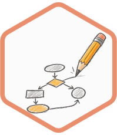
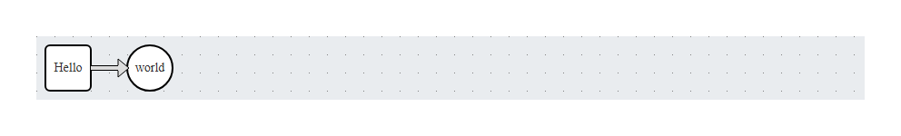

<!-- README.md is generated from README.Rmd. Please edit that file -->

# jointjs 

<!-- badges: start -->

[](https://github.com/pepijn-devries/jointjs/actions/workflows/R-CMD-check.yaml)
[](https://app.codecov.io/gh/pepijn-devries/jointjs)
<!-- badges: end -->

Create interactive ‘JointJS’ diagrams. This package wraps the [‘JointJS’
JavaScript library](https://www.jointjs.com/) to create interactive html
widgets. It will let the user draw and interact with diagrams.

## Installation

You can install the development version of jointjs from
[GitHub](https://github.com/) with:

``` r
# install.packages("pak")
pak::pak("pepijn-devries/jointjs")
```

## Example

This package uses [R6
class](https://r6.r-lib.org/articles/Introduction.html) objects to
create graphs and define its elements:

``` r
library(jointjs)
graph <-
  jointjs_graph$
  ## Create a new graph:
  new()$
  ## Add elements:
  add_elements(
    ## Add a rectangle:
    jointjs_rectangle$new(id = "hello")$
      set_body("white", "black", 2L, magnet = TRUE, rx = 5, ry = 5)$
      set_label("Hello", "black")$
      set_position(10, 10),
    ## Add a circle:
    jointjs_circle$new(id = "world")$
      set_body("white", "black", 2L, magnet = TRUE)$
      set_label("world", "black")$
      set_position(100, 10),
    ## Add a link, joining the rectangle and circle:
    jointjs_link$new(list(id = "hello"), list(id = "world"))$
      set_line("black", 2)
  )
## Get and show widget:
my_widget <- graph$get_widget(width = 170, height = 70)
```

<figure>

<figcaption aria-hidden="true">Widget Preview Example</figcaption>
</figure>

Note that this page cannot render interactive diagrams. Therefore, it
only shows a static screenshot of the widget generated by the code
chunk.
<!-- TODO refer to vignette with interactive example once available -->

## Alternatives

- [dagitty](https://www.dagitty.net/) A free web-based application and a
  matching R package used to draw, edit, and analyze causal diagrams.
- [diagram](https://cran.r-project.org/web/packages/diagram/index.html)
  Plots networks from transition matrices and plots food webs. It
  focuses on R base plots.
- [DiagrammeR](https://rich-iannone.github.io/DiagrammeR/): Build and
  manipulate nodes and edges programmatically using R syntax or
  specialized text languages. Supports DOT language to create diagrams.
- [ggdag](https://r-causal.github.io/ggdag/) A wrapper around
  [dagitty](https://www.dagitty.net/) that allows to add graph layers to
  [ggplots](https://ggplot2.tidyverse.org/).
- [ggraph](https://ggraph.data-imaginist.com/) A standard for
  [ggplot2](https://ggplot2.tidyverse.org/) users. It treats nodes and
  edges as standard ggplot layers (`geom_node_point()`,
  `geom_edge_link()`), allowing you to use familiar themes, scales, and
  facets for network data.
- [igraph](https://r.igraph.org/) Essential for network analysis in R.
  While primarily used for computing graph mathematics (centrality,
  paths), it includes robust base-R plotting capabilities
  (`plot.igraph`) for traditional network rendering.
- [networkD3](https://christophergandrud.github.io/networkD3/) Creates
  interactive force-directed graphs and node-link diagrams using
  [D3.js](https://d3js.org/). It is excellent for quick, clean, and
  responsive web animations with minimal code.
- [sigmajs](https://sigmajs.john-coene.com/) An interface to the
  [Sigma.js](https://www.sigmajs.org/) library, specifically optimized
  for rendering massive, complex graphs smoothly using WebGL.
- [visNetwork](https://datastorm-open.github.io/visNetwork/) Uses the
  [vis.js](https://visjs.org/) JavaScript library to create highly
  interactive, customisable network graphs. You can drag nodes, zoom,
  filter, and animate networks.

## Why use jointjs?

Alternatives listed above are good at rendering predefined graphs. But
most of them don’t let the user draw a graph and connect nodes on the
fly. If you need such user interaction, jointjs is for you.
